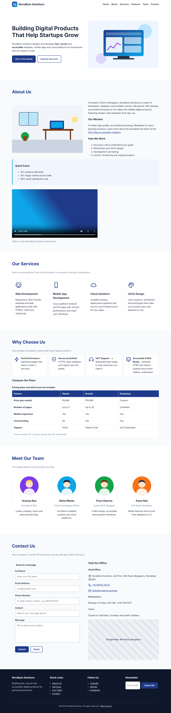
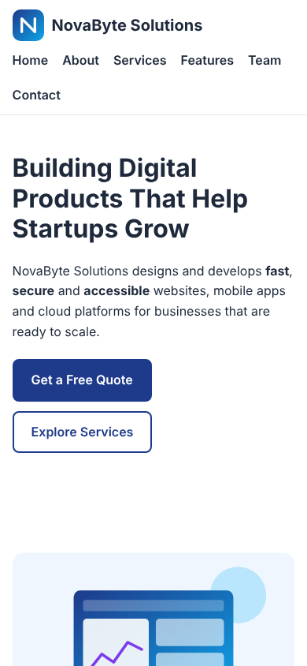

# NovaByte Solutions – Semantic HTML5 Website

**ApexLark Full Stack Development Internship – Day 01 Task**
**Topic:** HTML5 Fundamentals & Semantic Web Pages
**Intern:** _Your Name_ &nbsp;|&nbsp; **Date:** 02 November 2026

---

## Project Title

**NovaByte Solutions – Official Startup Website (HTML5 Structure)**

## Objective

To build a well-structured, semantic, accessible and responsive web page for a startup company
using HTML5, following modern web standards before any advanced styling or JavaScript is added.

## Features Implemented

### Page Sections
| # | Section | Semantic tags used |
|---|---------|--------------------|
| 1 | Header with logo | `<header>` |
| 2 | Navigation bar | `<nav>`, `<ul>` |
| 3 | Hero section | `<main>`, `<section>`, `<h1>` |
| 4 | About section | `<section>`, `<aside>`, `<figure>`, `<figcaption>` |
| 5 | Services section | `<section>`, `<article>` |
| 6 | Features section | `<section>`, `<ul>`, `<table>` |
| 7 | Team section | `<section>`, `<article>` |
| 8 | Contact section | `<section>`, `<form>`, `<address>`, `<iframe>` |
| 9 | Footer | `<footer>`, `<nav>` |

### HTML Elements
- **Headings H1–H6** in a meaningful hierarchy (one `<h1>`, then `<h2>` → `<h6>`)
- **Paragraphs**, `<strong>`, `<small>`
- **Ordered list** (“How We Work” steps) and **unordered lists** (Quick Facts, Features, Footer links)
- **Images** with descriptive `alt` text, plus `width`/`height` attributes
- **Hyperlinks** – internal (`#about`), external (`target="_blank" rel="noopener noreferrer"`), `mailto:` and `tel:`
- **Table** with `<caption>`, `<thead>`, `<tbody>`, `<tfoot>`, `scope` attributes and `colspan`
- **Buttons** – Submit, Reset and Subscribe
- **Video** – `<video>` with `controls`, `poster` and fallback text
- **Embedded Google Map** using `<iframe>` with a `title`

### Contact Form (HTML5 Validation)
| Field | Type | Validation |
|-------|------|-----------|
| Full Name | `text` | `required`, `minlength="3"`, `placeholder` |
| Email Address | `email` | `required`, `type="email"`, `placeholder` |
| Phone Number | `tel` | `required`, `type="tel"`, `pattern="[0-9]{10}"`, `placeholder` |
| Subject | `text` | `required`, `placeholder` |
| Message | `textarea` | `required`, `placeholder` |
| Submit / Reset | `button` | `type="submit"` / `type="reset"` |

Every input has a matching `<label for="...">`, and the fields are grouped in a `<fieldset>` with a `<legend>`.

### Accessibility & SEO
- Descriptive `<title>` and `<meta name="description">`
- `lang="en"`, `charset` and `viewport` meta tags (responsive on mobile)
- Open Graph meta tags for social link previews
- `alt` text on all meaningful images (decorative icons use `alt=""`)
- “Skip to main content” link for keyboard users
- `aria-label` on navigation landmarks and `aria-labelledby` on sections
- Logical heading order and semantic landmarks

## Folder Structure

```
Day-01-HTML/
│
├── index.html                  # Main semantic HTML5 web page
├── README.md                   # Project documentation
├── screenshots/
│   ├── homepage.png            # Full-page screenshot (desktop)
│   └── mobile-view.png         # Mobile screenshot
└── assets/
    ├── images/
    │   ├── hero-illustration.svg
    │   ├── about-office.svg
    │   ├── team-member-1.svg … team-member-4.svg
    │   └── video-poster.jpg
    ├── icons/
    │   ├── logo.svg
    │   ├── web-development.svg, mobile-app.svg, cloud.svg, design.svg
    │   ├── speed.svg, security.svg, support.svg
    │   └── email.svg, phone.svg, location.svg
    └── media/
        └── intro-video.mp4
```

## How to Run

1. Clone the repository:
   ```bash
   git clone https://github.com/<your-username>/Day-01-HTML.git
   ```
2. Open the `Day-01-HTML` folder in **Visual Studio Code**.
3. Open `index.html` in **Google Chrome** (double-click it), or right-click → **Open with Live Server** if you have the Live Server extension.
4. An internet connection is needed for the embedded Google Map to load.

## HTML Validation

The page was checked with the **W3C Markup Validation Service** (https://validator.w3.org/#validate_by_upload)
by uploading `index.html` and fixing every reported issue. Result: **Document checking completed. No errors or warnings to show.**

## Screenshot

### Desktop


### Mobile


## Tools Used
- HTML5
- Visual Studio Code
- Google Chrome
- W3C HTML Validator
- Git & GitHub

## Learning Outcomes
- Built a complete page using semantic HTML5 elements
- Created an accessible contact form with built-in HTML5 validation
- Structured data in a table with caption and header scopes
- Applied accessibility (a11y) and SEO best practices
- Organised project files professionally and published the code on GitHub

---
© 2026 NovaByte Solutions (fictional company created for the ApexLark internship task).
